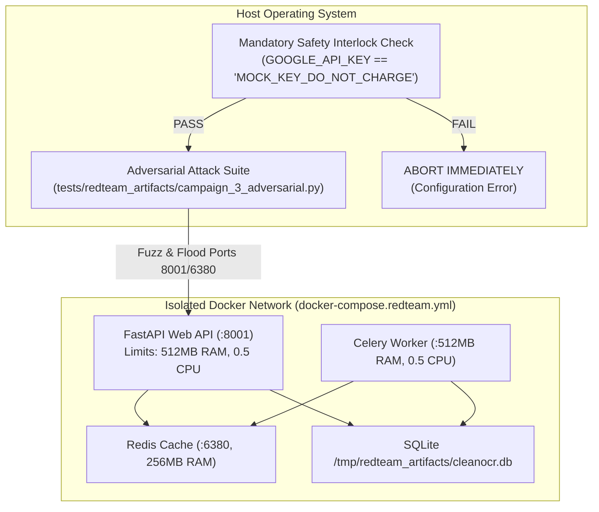
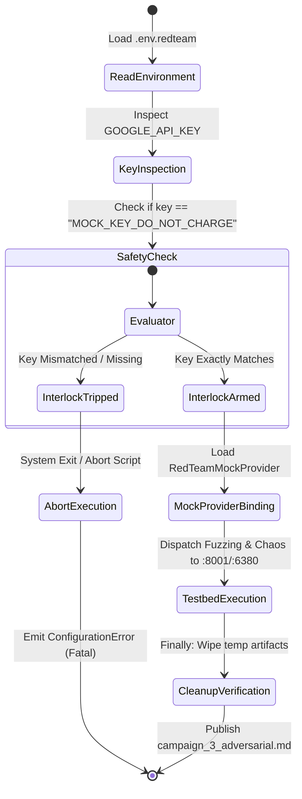
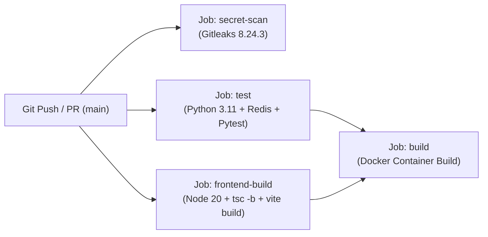

# Implementation Plan: Set C — Validation & Adversarial Testing

> **Status:** 🎯 Requirements & Discovery Approved (@PM) — Ready for Architectural & Adversarial Execution  
> **Authors:** @PM, @Architect, @Eng, @Des, @RedTeam, @QA  
> **Target:** RedTeam Testbed, Historical OCR Pipeline, GitHub Actions CI/CD, React Frontend  
> **Governing Standards:** [`AGENTS.md`](AGENTS.md) — Production First, Strict TDD, Full Observability, Zero Raw Alerts, Continuous Documentation Continuity, Human-in-the-Loop Git Decisions  
> **Preceding Phases:** Set A (Security & Access Control) — ✅ Completed | Set B (Persistence & Storage) — ✅ Completed  

---

## 1. Executive Summary & Product Requirements (@PM)

### Problem Statement
With Set A (Security & Access Control) and Set B (Persistence & Storage) fully operational and committed, the CleanOCR architecture features API Key authentication, Redis token-bucket rate limiting, and SQLAlchemy 2.0 dual-engine persistence (SQLite WAL / PostgreSQL). However, the platform has not yet been subjected to comprehensive adversarial fuzzing, fault-injection chaos, real 19th-century multi-column historical PDF verification, or complete end-to-end continuous integration gating including the modern React/TypeScript frontend.

### Objectives & Scope (Set C)
1. **Phase 13 RedTeam Chaos Campaign (@RedTeam):**
   - **Safety Interlock:** Strictly enforce Ping Check interlock (`GOOGLE_API_KEY == "MOCK_KEY_DO_NOT_CHARGE"`). Abort immediately if live credentials or external network access are detected.
   - **Target Isolation:** Run against isolated `docker-compose.redteam.yml` (capped at 512MB RAM, 0.5 CPU, Redis capped at 256MB).
   - **Vector 1: Auth & Rate Limiting Fuzzing:** Test spoofed headers (`X-Forwarded-For`, `X-Real-IP`), bearer token tampering, timing attack resistance (`secrets.compare_digest`), and token bucket exhaustion.
   - **Vector 2: Database & SQL Injection Fuzzing:** Hammer `GET /jobs?search=` and `GET /jobs?status=` with SQL injection payloads and SQLite dialect stress.
   - **Vector 3: Binary Corruption & Payload Fuzzing:** Malformed PDFs (broken xref tables, truncated streams, polyglot ZIP/PDF, decompression bombs, 0-byte files).
   - **Vector 4: Chaos & Fault Injection:** Simulate Redis disconnects during active Celery chord execution, worker termination mid-job, and SQLite lock contention.
   - **Hygiene:** Strict cleanup in `finally` blocks; publish `campaign_3_adversarial.md`.

2. **Live Historical PDF End-to-End Validation (@QA):**
   - Process real 19th-century multi-column scans from `latter_day_saints_messenger_and_advocate_vol_1_and_2.pdf`.
   - Validate live transcription via `gemini-3.1-flash-lite` (Standard Tier).
   - Verify low-resolution pre-flight layout classification (`LAYOUT_PROMPT` with `MEDIA_RESOLUTION_LOW` ~258 tokens).
   - Verify dynamic gutter padding applied strictly to multi-column pages.
   - Verify citation metadata persistence in SQLite and side-by-side verification in `DiffViewer.tsx`.
   - Maintain 100% regression test pass rate across the full test bed (161+ tests).

3. **CI/CD Pipeline Automation (@Eng):**
   - Update `.github/workflows/ci.yml` to include:
     - `secret-scan`: gitleaks credential scanning.
     - `test`: Python 3.11 with Redis service, system libraries (`poppler-utils`, `libmagic1`), dependencies, and `pytest`.
     - `frontend-build`: Node.js 20.x, TypeScript build check (`tsc -b`), and Vite production compilation (`npm run build`).
     - `build`: Docker container build gated on both `test` and `frontend-build`.
   - Update `tests/test_ci_pipeline.py` using Strict TDD to assert the enhanced CI pipeline structure.

4. **Continuous Documentation Continuity (@QA Clearinghouse):**
   - Proactive suggestions logged across all personas (@PM, @Arch, @Eng, @Des, @RedTeam).
   - `@QA` evaluates, approves, and executes updates across `ARCHITECTURE.md` and `README.md`.

5. **Git Commit Strategy & Human Decision Gate (@QA):**
   - Formulate structured atomic commit recommendations for human review and final approval.

---

## 2. System Architecture & Attack Surface Design (@Arch)

### A. Architectural Overview & RedTeam Isolation Topology



### B. Attack Vector Matrix & Resilience Expectations

| Vector ID | Target Subsystem | Attack Payload / Scenario | Expected Defensive Behavior | Severity if Failed |
| :--- | :--- | :--- | :--- | :--- |
| **V-01** | Rate Limiter | Spoofed `X-Forwarded-For` / `X-Real-IP` IP cycling | Request tracked by direct peer IP unless trusted reverse proxy configured; bucket enforced. | High (Quota Exhaustion) |
| **V-02** | Rate Limiter | Rapid burst of 20 uploads in 1 second | First 3 succeed, subsequent 17 return structured HTTP 429 with `Retry-After`. | High (Cost Inflation) |
| **V-03** | Auth Module | Timing attack / brute-force byte guessing on `X-API-Key` | Constant-time evaluation via `secrets.compare_digest`; no timing side-channel. | Medium (Key Leakage) |
| **V-04** | Auth Module | Malformed headers (`Bearer null`, SQL injection in header) | Clean HTTP 401 Unauthorized with structured error envelope. | Medium (Bypass Risk) |
| **V-05** | Relational DB | SQL Injection on `GET /jobs?search=' OR 1=1 --` | SQLAlchemy 2.0 ORM parameterization treats payload as literal string; 0 rows or valid matches. | Critical (Data Leak) |
| **V-06** | Relational DB | Fuzzing `status` param with non-enum strings | Pydantic regex validator rejects invalid status with HTTP 422 Unprocessable Entity. | Low (Validation Drift) |
| **V-07** | Relational DB | 50 concurrent DB reads & writes | SQLite WAL mode (`PRAGMA journal_mode=WAL;`) and 30s timeout prevent `database is locked`. | High (Worker Starvation) |
| **V-08** | Ingestion Engine | Corrupted PDF xref tables / truncated byte stream | `pdf2image` / Poppler raises handled error; worker marks job `failed` with sanitized message. | Medium (Crash Loop) |
| **V-09** | Ingestion Engine | Polyglot PDF+ZIP and Decompression Bomb | `python-magic` and file limit guards reject payload with HTTP 400 Bad Request. | High (DoS) |
| **V-10** | Distributed Core | Redis broker crash/disconnect mid-task | Server returns structured HTTP 500/503; worker logs disconnect and reconnects cleanly without zombie process. | Critical (System Deadlock) |

### C. Safety Interlock State Machine



### D. Explicit Adversarial API Contracts & Structured Envelopes

#### 1. Adversarial Ingestion Contract (`POST /upload`)
*   **Method / Route:** `POST /upload`
*   **Headers:**
    *   `X-API-Key` (Optional/Enforced): Validates access token when `CLEANOCR_API_KEY` is set.
    *   `X-Forwarded-For` / `X-Real-IP`: Evaluated by `RateLimiter` sliding window.
*   **Body:** `multipart/form-data` with `file: UploadFile` and optional citation metadata form fields (`title`, `volume`, `issue`, `date`).
*   **Adversarial Bounds:**
    *   `Content-Length > 100MB` ➔ HTTP 413 Payload Too Large / HTTP 400 Bad Request.
    *   MIME spoofing (non-PDF header with `.pdf` extension) ➔ HTTP 400 Bad Request (`INVALID_FILE`).
    *   Burst uploads (>3 req/min) ➔ HTTP 429 Too Many Requests with `Retry-After: <seconds>`.
    *   Invalid/tampered `X-API-Key` ➔ HTTP 401 Unauthorized (`UNAUTHORIZED`).

#### 2. Adversarial Query & SQL Injection Contract (`GET /jobs`)
*   **Method / Route:** `GET /jobs`
*   **Query Parameters:**
    *   `page`: integer, `ge=1` (fuzzed with negative, zero, and huge values).
    *   `limit`: integer, `ge=1, le=100` (fuzzed with >100 values to assert clamping).
    *   `status`: string regex `^(queued|processing|completed|failed)$` (fuzzed with SQL injection and non-enum strings to assert HTTP 422).
    *   `search`: string `max_length=100` (fuzzed with `' OR 1=1 --`, `UNION SELECT`, and nested quotes to assert parameterized safety).
*   **Response on Validation Failure:** HTTP 422 Unprocessable Entity with standard FastAPI detail envelope.

#### 3. Standardized Error Envelope (`app/api/server.py`)
All application-level HTTP errors conform to the top-level structured envelope:
```json
{
  "error": {
    "code": "RATE_LIMIT_EXCEEDED | UNAUTHORIZED | INVALID_FILE | JOB_NOT_FOUND",
    "message": "Human-readable description of the constraint violation",
    "details": {}
  }
}
```

### E. As-Built Container & Package Topology Alignment
1.  **Entry Point Alignment:** `docker-compose.redteam.yml` web service updated to `uvicorn app.api.server:app` and worker updated to `celery -A app.workers.celery_worker.celery_app worker` in lockstep with the Phase 18 package architecture.
2.  **Mock Provider Contract:** `tests/redteam_artifacts/mock_vision.py::RedTeamMockProvider` conforms to `OCRProvider`, implements `detect_layout_type(image) -> str` (returning `"single-column"`), and imports all static typing symbols (`from typing import Any`).
3.  **Sandboxed Storage:** Volume mounts isolate `uploads/` and `workspaces/` inside `tests/redteam_artifacts/`, guaranteeing zero write contamination of root workspaces during adversarial runs.

---

## 3. CI/CD Matrix Architecture & TDD Strategy (@Eng)

### A. CI Workflow Schema (`.github/workflows/ci.yml`)



### B. Strict TDD Execution Sequence
1.  **Write Failing Tests First (`tests/test_ci_pipeline.py`):**
    - `test_has_frontend_build_job`: Asserts `.github/workflows/ci.yml` declares a `frontend-build` job.
    - `test_frontend_build_runs_on_ubuntu`: Asserts runner is `ubuntu-latest`.
    - `test_frontend_build_sets_up_node`: Asserts `actions/setup-node` step with Node 20.
    - `test_frontend_build_executes_build`: Asserts `npm run build` or `npm test` step.
    - `test_docker_build_needs_frontend_build`: Asserts `build` job depends on both `test` and `frontend-build`.
2.  **Verify Test Fails:** Run pytest to verify assertions fail as expected.
3.  **Implement Updates:** Modify `.github/workflows/ci.yml` to satisfy the contracts.
4.  **Verify Test Passes:** Run pytest to verify all CI assertions pass green.

---

## 4. UI/UX Verification & Design Standards (@Des)

### Standards to Verify
1. **Responsive Viewport Audit (320px - 4k):**
   - Audit `DiffViewer.tsx` and `JobHistory.tsx` on 320px mobile viewport with real multi-column extracted text.
   - Verify stacked layout, absence of horizontal scrolling, and legible typography (`Inter` / `JetBrains Mono`).
2. **Adversarial Error UI Feedback:**
   - Verify that HTTP 429 Too Many Requests triggers the `NotificationToast.tsx` animated banner with the live second-by-second countdown.
   - Verify that HTTP 401 Unauthorized triggers the toast with the 1-click "Configure API Key" button opening `SettingsModal.tsx`.
   - Zero raw `window.alert` calls.

---

## 5. Documentation Continuity & Suggestions Clearinghouse Protocol

### Mandate
Every active persona must document suggestions for clean, frictionless support for future AI agents and human collaborators. `@QA` acts as the centralized clearinghouse: collects, evaluates, decides if/how to implement, and applies the documentation changes before milestone sign-off.

### Agent Suggestion Log
| Persona | Target Doc | Friction / Opportunity Identified | Proposed Improvement | @QA Verdict |
| :--- | :--- | :--- | :--- | :--- |
| **🧠 @PM** | `README.md` | Testing instructions omit isolated RedTeam execution and CI/CD matrix explanation | Document `docker-compose.redteam.yml` setup, Ping Check interlock, and GitHub Actions workflow stages. | Pending @QA |
| **🧠 @PM** | `ARCHITECTURE.md` | System architecture does not document the RedTeam isolation topology or safety interlock | Add RedTeam container topology diagram and safety interlock state machine to §7 Security Architecture. | Pending @QA |
| **🏗️ @Arch** | `ARCHITECTURE.md` | CI/CD testing pipeline dependencies lack frontend gating documentation | Add §9 CI/CD Pipeline section detailing the parallel Python backend and Node.js frontend gating architecture. | Pending @QA |
| **🔨 @Eng** | `ARCHITECTURE.md` | RedTeam mock vision configuration requires explicit instructions on mock providers | Document `RedTeamMockProvider` and `.env.redteam` configuration in testing manual. | Pending @QA |
| **😈 @RedTeam** | `tests/redteam_artifacts/README.md` | RedTeam artifacts directory lacks execution instructions and cleanup guidelines | Create a README in `tests/redteam_artifacts/` detailing safety protocols, ping checks, and execution scripts. | Pending @QA |
| **🎨 @Des** | `ARCHITECTURE.md` | Responsive breakpoint standards (320px mobile stack) are not explicitly specified | Document mobile layout breakpoints and responsive diff viewing guidelines in §6 Frontend Architecture. | Pending @QA |

---

## 6. Git Commit Strategy & Human Decision Gate (@QA)

### Protocol
*   **Mandatory Human Loop-In:** Upon completing all verification tests and executing approved documentation changes, `@QA` must loop the human user in.
*   **Structured Recommendations:** `@QA` presents a structured Git staging and commit plan, organizing changes into logical, atomic units (e.g., `feat:`, `fix:`, `docs:`, `test:`, `refactor:`) with draft commit messages and explicit file lists.
*   **Human Authority:** The human user has sole authority to decide how changes are committed to git.

---

## 7. Persona Exit Gates & Verification (@AGENTS.md)

| Persona | Exit Gate Requirement | Status |
| :--- | :--- | :--- |
| **🧠 @PM** | Requirements breakdown, acceptance criteria, roadmap alignment, `task.md` & `Context.md` updated, doc suggestions logged | ✅ Completed |
| **🏗️ @Arch** | RedTeam isolation design, CI/CD workflow architecture, attack vector matrix defined, doc suggestions logged | In Queue |
| **😈 @RedTeam** | Safety interlock verified (`MOCK_KEY_DO_NOT_CHARGE`), fuzzing & chaos campaigns executed, `campaign_3_adversarial.md` saved, cleanup verified, doc suggestions logged | In Queue |
| **🔨 @Eng** | Strict TDD (failing CI tests first), `.github/workflows/ci.yml` updated, 100% tests green, doc suggestions logged | In Queue |
| **🎨 @Des** | 320px mobile viewport verified with historical document, error toasts & countdown verified, zero raw alerts, doc suggestions logged | In Queue |
| **🕵️ @QA** | Live historical PDF E2E verified, proof in `walkthrough.md`, `Retrospective.md` updated, **Documentation Clearinghouse executed**, **Git Commit Recommendation presented to human** | In Queue |

---

## 8. Acceptance Criteria
1. [ ] Safety interlock script verifies `GOOGLE_API_KEY == "MOCK_KEY_DO_NOT_CHARGE"` before any adversarial script runs.
2. [ ] RedTeam Campaign 3 completes fuzzing across Rate Limiter, Auth, SQL injection, binary corruption, and chaos fault injection with clean system survival.
3. [ ] All RedTeam artifacts are strictly confined to `tests/redteam_artifacts/` and cleaned up upon execution.
4. [ ] Real multi-column historical scan (`latter_day_saints_messenger_and_advocate_vol_1_and_2.pdf`) successfully processes through the live pipeline with `gemini-3.1-flash-lite`.
5. [ ] Dynamic layout classification properly classifies multi-column vs single-column pages and applies padding selectively.
6. [ ] Side-by-side verification and metadata are visible and responsive on both 320px mobile and desktop in `DiffViewer.tsx`.
7. [ ] `.github/workflows/ci.yml` includes secret-scan, python 3.11 test suite, frontend-build (tsc & vite build), and docker build gates.
8. [ ] `tests/test_ci_pipeline.py` verifies the enhanced CI/CD workflow structure.
9. [ ] 100% test pass rate across the full test bed (161+ tests passing).
10. [ ] All persona documentation suggestions are evaluated and executed by `@QA` in the Documentation Clearinghouse.
11. [ ] `@QA` loops the human user in with a structured Git commit recommendation, and the human decides how to commit the session changes.
