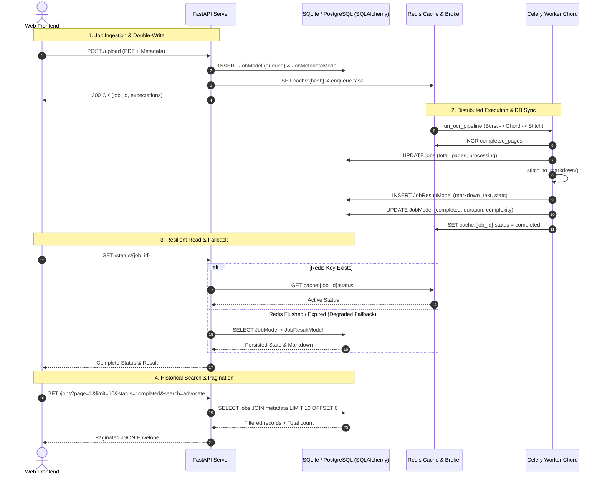
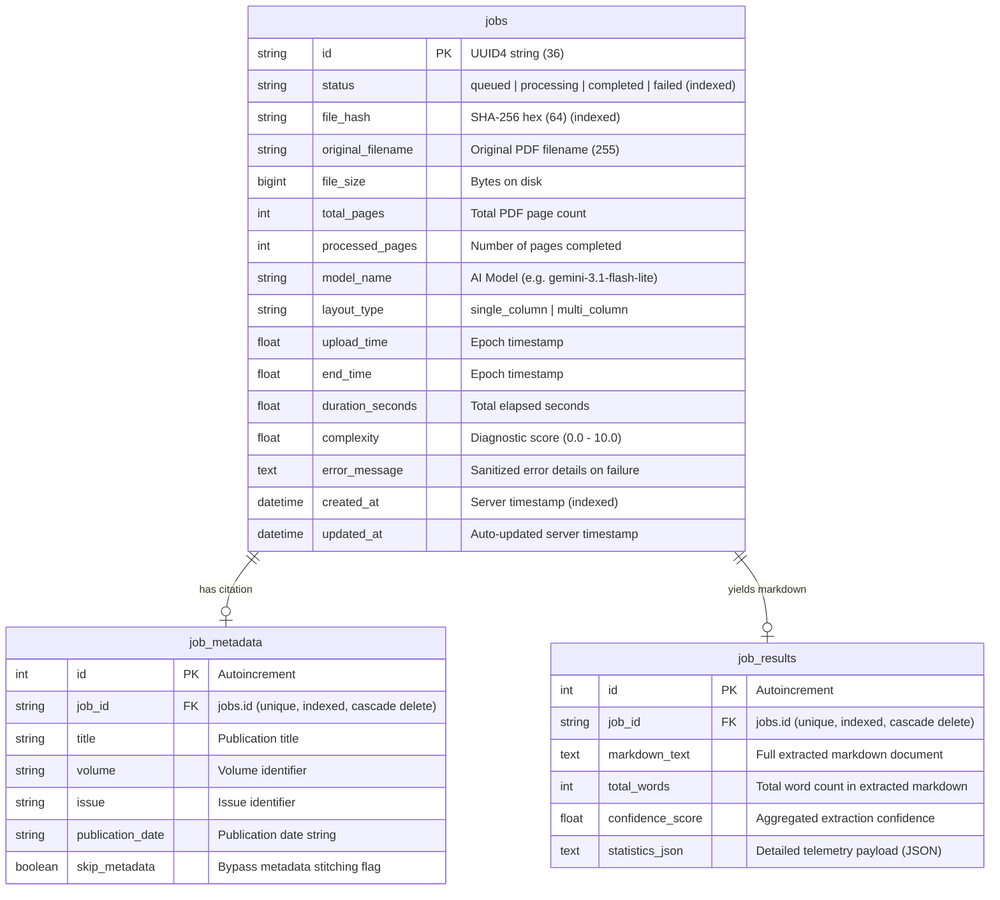

# Implementation Plan: Set B — Persistence & Storage

> **Status:** 🏗️ System Design Approved (@Arch) — Ready for Strict TDD Construction (@Eng)  
> **Authors:** @PM, @Architect, @Eng, @Des, @QA  
> **Target:** FastAPI Backend, SQLAlchemy 2.0, Celery Beat, React Frontend  
> **Governing Standards:** [`AGENTS.md`](AGENTS.md) — Production First, Strict TDD, Full Observability, Zero Raw Alerts, Continuous Documentation Continuity, Human-in-the-Loop Git Decisions  
> **Preceding Phase:** Set A (Security & Access Control) — ✅ Fully Verified & Closed  

---

## 1. Executive Summary & Product Requirements (@PM)

### Problem Statement
Currently, CleanOCR relies on Redis for active job coordination and client-side `localStorage` for job history. If Redis is restarted or memory is evicted, server-side job records are lost. Furthermore, `localStorage` is unbounded, causing performance degradation after 100+ uploads, and does not synchronize across browser sessions or devices. Finally, `workspaces/{job_id}` and `uploads/` accumulate indefinitely on disk without a lifecycle retention daemon.

### Objectives & Scope (Set B)
1. **Relational Database Engine:**
   - Integrate SQLAlchemy 2.0 with a zero-configuration SQLite default (`workspaces/cleanocr.db`), switchable to PostgreSQL via `DATABASE_URL` in production/Docker.
   - Persist job records (`jobs`), citation metadata (`job_metadata`), and markdown extraction outputs (`job_results`).
   - Track AI model telemetry in the schema (`model_name`, `layout_type`, `total_pages`, `duration_seconds`) to support the Model Lifecycle Roadmap (Gemini 3.1 Flash Lite / 3.8 Flash).
2. **Persistent Job History API:**
   - Implement `GET /jobs` with pagination (`page`, `limit`), status filtering (`queued`, `processing`, `completed`, `failed`), search by filename/title, and sorting.
   - Implement `GET /jobs/{job_id}` to retrieve historical markdown text and diagnostic stats even after Redis cache expiration.
   - Protect both routes with Set A's `verify_api_key` and Redis `RateLimiter`.
3. **Workspace Retention Daemon:**
   - Implement an automated Celery Beat task pruning expired workspaces and uploads older than `WORKSPACE_TTL_HOURS` (default: 24h), while keeping the DB records intact.
4. **Frontend Job History & Sync (@Des):**
   - Upgrade the frontend job history interface to display a paginated, searchable, status-filtered grid/table with mobile-first responsiveness (down to 320px).
   - Support loading historical extractions directly into `DiffViewer.tsx`.
5. **Continuous Documentation Continuity Protocol:**
   - Every participating persona must document suggestions for clean, frictionless support for future AI agents and human collaborators.
   - `@QA` acts as the centralized clearinghouse: collects, evaluates, decides if/how to implement, and applies the documentation changes before milestone sign-off.
6. **Git Commit Strategy & Human Decision Gate:**
   - At the conclusion of the fully verified session, `@QA` loops the human in with a structured Git commit recommendation (atomic groupings, conventional commit messages, staged files).
   - The human makes the final decision on how the work is committed.

---

## 2. System Architecture & Database Design (@Arch)

### A. Architectural Overview & State Flow

CleanOCR uses a dual-layer state strategy:
1. **Redis (Volatile Fast-Path):** Real-time progress counters (`cache:{job_id}:completed_pages`), token-bucket rate limits, task locks, and Server-Sent Events broadcasting.
2. **SQLAlchemy 2.0 (Durable Relational Persistence):** Master record of all historical jobs, metadata, execution diagnostics, and final markdown texts. If Redis restarts or evicts keys, the application gracefully degrades to the database.



---

### B. Entity-Relationship Schema (`app/db/models.py`)



---

### C. Database Connection & Lifespan Architecture (`app/db/database.py`)

*   **Configuration (`app/core/config.py`):**
    ```python
    DATABASE_URL = os.getenv("DATABASE_URL", "sqlite:///./workspaces/cleanocr.db")
    ```
*   **Engine & Pooling:**
    *   For SQLite: Uses `connect_args={"check_same_thread": False}`.
    *   For PostgreSQL: Standard connection pooling with `pool_pre_ping=True` and `pool_size=10, max_overflow=20`.
*   **Dependency Injection for FastAPI:**
    ```python
    def get_db():
        db = SessionLocal()
        try:
            yield db
        finally:
            db.close()
    ```
*   **Worker Context Manager:**
    ```python
    @contextmanager
    def get_db_context():
        db = SessionLocal()
        try:
            yield db
            db.commit()
        except Exception:
            db.rollback()
            raise
        finally:
            db.close()
    ```
*   **Lifespan Hook (`app/api/server.py`):**
    Calls `init_db()` upon server startup, ensuring `workspaces/` exists and tables are created before the first request is served.

---

### D. Explicit API Contracts

#### 1. `GET /jobs`
*   **Description:** Retrieve a paginated, filterable, and searchable list of historical jobs.
*   **Authentication:** Protected by `verify_api_key` (if `CLEANOCR_API_KEY` is configured).
*   **Rate Limit:** 60 requests per minute (`RateLimiter(60, 60)`).
*   **Query Parameters:**
    | Parameter | Type | Required | Default | Validation | Description |
    | :--- | :--- | :--- | :--- | :--- | :--- |
    | `page` | `int` | No | `1` | `ge=1` | Page number (1-indexed) |
    | `limit` | `int` | No | `10` | `ge=1, le=100` | Number of items per page |
    | `status` | `str` | No | `None` | `regex="^(queued\|processing\|completed\|failed)$"` | Filter by status |
    | `search` | `str` | No | `None` | `max_length=100` | Substring match on filename or title |
    | `sort_order` | `str` | No | `"desc"` | `regex="^(asc\|desc)$"` | Sort by created_at |

*   **Success Response (HTTP 200 OK):**
    ```json
    {
      "items": [
        {
          "job_id": "c1f7a0b3-96f1-4f0e-b7d1-0f7f32997e33",
          "status": "completed",
          "original_filename": "messenger_and_advocate_vol1.pdf",
          "file_size": 1542389,
          "total_pages": 16,
          "processed_pages": 16,
          "model_name": "gemini-3.1-flash-lite",
          "layout_type": "multi_column",
          "upload_time": 1793635200.0,
          "end_time": 1793635274.2,
          "duration_seconds": 74.2,
          "complexity": 4.8,
          "error_message": null,
          "metadata": {
            "title": "Latter Day Saints' Messenger and Advocate",
            "volume": "1",
            "issue": "1",
            "publication_date": "1834-10"
          },
          "created_at": "2026-11-02T16:00:00Z"
        }
      ],
      "total": 35,
      "page": 1,
      "limit": 10,
      "total_pages": 4
    }
    ```

#### 2. `GET /jobs/{job_id}`
*   **Description:** Retrieve full details of a specific job, including the persisted markdown text.
*   **Authentication:** Protected by `verify_api_key`.
*   **Rate Limit:** 60 requests per minute.
*   **Path Parameter:** `job_id: str` (UUID string).
*   **Success Response (HTTP 200 OK):**
    ```json
    {
      "job_id": "c1f7a0b3-96f1-4f0e-b7d1-0f7f32997e33",
      "status": "completed",
      "original_filename": "messenger_and_advocate_vol1.pdf",
      "file_size": 1542389,
      "total_pages": 16,
      "processed_pages": 16,
      "model_name": "gemini-3.1-flash-lite",
      "layout_type": "multi_column",
      "upload_time": 1793635200.0,
      "end_time": 1793635274.2,
      "duration_seconds": 74.2,
      "complexity": 4.8,
      "error_message": null,
      "metadata": {
        "title": "Latter Day Saints' Messenger and Advocate",
        "volume": "1",
        "issue": "1",
        "publication_date": "1834-10"
      },
      "result": {
        "markdown_text": "# Latter Day Saints' Messenger and Advocate...",
        "total_words": 8420,
        "confidence_score": 0.98,
        "statistics": { ... }
      },
      "created_at": "2026-11-02T16:00:00Z"
    }
    ```
*   **Error Response (HTTP 404 Not Found):**
    ```json
    {
      "error": {
        "code": "JOB_NOT_FOUND",
        "message": "Job c1f7a0b3-96f1-4f0e-b7d1-0f7f32997e33 was not found in persistence records."
      }
    }
    ```

#### 3. `GET /status/{job_id}` (Updated Contract with DB Fallback)
*   **Description:** Live status tracking. Queries Redis fast-path; falls back to DB if Redis is cleared.
*   **Authentication:** Protected by `verify_api_key`.
*   **Rate Limit:** 60 requests per minute.
*   **Behavior on Redis Cache Miss:** Queries `jobs` and `job_results` table in DB. Returns status, progress (100 if completed), and markdown without raising 404 if the job exists in the DB.

---

### E. Workspace Retention Strategy (`WORKSPACE_TTL_HOURS`)

*   **Daemon:** Scheduled hourly Celery Beat task `cleanup_old_workspaces`.
*   **Target Files for Pruning:**
    *   Directory `workspaces/{job_id}/` (heavy image bursts, raw OCR JSONs).
    *   File `uploads/{job_id}.pdf` (temporary uploaded PDF).
    *   Redis keys `cache:{job_id}:*`.
*   **Preserved State:**
    *   SQLAlchemy `jobs`, `job_metadata`, and `job_results` records are **NEVER deleted** by the retention daemon.
    *   Extracted Markdown and diagnostics remain permanently queryable via `GET /jobs` and `GET /jobs/{job_id}`.

---

## 3. Construction Plan & Strict TDD Strategy (@Eng)

Per [`AGENTS.md`](AGENTS.md), **no implementation code without a test written first.**

### Step 1: Write Failing Tests (`tests/test_persistence_db.py`)
1.  `test_database_initialization`: Verifies SQLite schema creation and tables presence.
2.  `test_job_crud_lifecycle`: Asserts model persistence, metadata relationship cascade, and result attachment.
3.  `test_upload_persists_to_database`: Asserts `POST /upload` writes job and metadata records to DB.
4.  `test_get_jobs_pagination`: Asserts `page`, `limit`, `total`, and page clamping.
5.  `test_get_jobs_filtering_and_search`: Asserts status filtering (`status=completed`) and search substring matching (`search=messenger`).
6.  `test_get_jobs_endpoint_auth_and_ratelimit`: Asserts 401 when API key configured and rate limit throttling.
7.  `test_status_endpoint_db_fallback`: Asserts that when Redis keys are completely flushed, `GET /status/{job_id}` retrieves state from SQLite DB.
8.  `test_get_job_by_id_endpoint`: Asserts 200 with complete markdown and 404 on invalid UUID.
9.  `test_workspace_cleanup_preserves_db`: Asserts that expired files are deleted from disk while database rows remain intact.

### Step 2: Implementation Sequence
1.  **Dependencies:** Add `sqlalchemy>=2.0.0` to `requirements.txt` and run `pip install`.
2.  **Config:** Expose `DATABASE_URL` in `app/core/config.py`.
3.  **Database Module:** Implement `app/db/__init__.py`, `app/db/database.py`, and `app/db/models.py`.
4.  **Backend Integration:**
    *   Initialize DB in `app/api/server.py` startup.
    *   Persist initial job in `upload_file`.
    *   Update `celery_worker.py` to write completion/failure records to DB.
    *   Implement `GET /jobs` and `GET /jobs/{job_id}` endpoints in `server.py`.
    *   Update `_build_status_payload` in `server.py` to query DB if Redis returns None.
5.  **Build Verification:** Run `python -m pytest` ensuring 100% test pass rate.

---

## 4. UI/UX Design Standards & Frontend Specifications (@Des)

### A. Persistent Job History Interface (`frontend/src/components/JobHistory.tsx`)
*   **Visual Hierarchy:** Clean, glassmorphic card table with subtle borders and status badges:
    *   `completed`: Green indicator badge (`bg-emerald-500/10 text-emerald-400 border-emerald-500/20`).
    *   `processing`: Blue animated pulse badge (`bg-cyan-500/10 text-cyan-400 border-cyan-500/20`).
    *   `queued`: Amber indicator badge (`bg-amber-500/10 text-amber-400 border-amber-500/20`).
    *   `failed`: Rose indicator badge (`bg-rose-500/10 text-rose-400 border-rose-500/20`).
*   **Search & Filtering Toolbar:**
    *   Search input with debounced querying against filename or publication title.
    *   Segmented filter buttons: `All`, `Completed`, `Processing`, `Failed`.
*   **Actions:**
    *   "Open Diff": Loads original PDF and saved Markdown into `DiffViewer.tsx`.
    *   "Download Markdown": 1-click export of the extracted `.md` document.
*   **Responsive Viewport Support (320px - 4k):**
    *   On desktop: Clean tabular layout with filename, date, model tag, page count, and action buttons.
    *   On mobile (<640px): Stacks into individual cards with clear spacing to avoid horizontal scroll and crushed columns.

---

## 5. Documentation Continuity & Suggestions Clearinghouse Protocol

### Mandate
To guarantee frictionless onboarding and collaboration for both human developers and future AI agents, every persona is required to contribute proactive documentation improvement suggestions. The `@QA` role serves as the central clearinghouse and final arbiter: evaluating each suggestion, deciding if and how it should be implemented, and executing the documentation changes in `ARCHITECTURE.md`, `README.md`, or relevant manuals before concluding the phase.

### Agent Suggestion Log
| Persona | Target Doc | Friction / Opportunity Identified | Proposed Improvement | @QA Verdict |
| :--- | :--- | :--- | :--- | :--- |
| **🧠 @PM** | `ARCHITECTURE.md` | §5 Data Storage currently states job state is volatile in Redis and client-side only | Add comprehensive SQLite/PostgreSQL schema section and entity relationship map for `jobs`, `job_metadata`, and `job_results`. | Pending @QA |
| **🧠 @PM** | `README.md` | Setup instructions omit `DATABASE_URL` configuration and automatic SQLite creation | Document zero-config SQLite `workspaces/cleanocr.db` default and Docker PostgreSQL environment variable setup. | Pending @QA |
| **🏗️ @Arch** | `ARCHITECTURE.md` | Fast-path Redis + DB fallback architecture needs explicit sequence diagram | Add mermaid sequence diagram illustrating active job reading from Redis and historical fallback to DB. | Pending @QA |
| **🏗️ @Arch** | `ARCHITECTURE.md` | Celery Beat workspace cleaner behavior with DB retention is undocumented | Document that `cleanup_old_workspaces` prunes heavy images/temp files while preserving `jobs` and `job_results` in the relational DB. | Pending @QA |
| **🔨 @Eng** | `ARCHITECTURE.md` | Concurrent worker SQLite access can trigger "database is locked" errors without WAL mode | Document SQLite `PRAGMA journal_mode=WAL;` and `timeout=30.0` configuration in `database.py` and requirement for PostgreSQL in multi-worker production. | Pending @QA |
| **🔨 @Eng** | `ARCHITECTURE.md` | SQLAlchemy Declarative Base reserves `Base.metadata`, causing conflicts if a model relationship is named `metadata` | Document mapping convention: name ORM relationship `citation_metadata` while serializing dictionary key as `"metadata"` to preserve API contracts. | Pending @QA |
| **🎨 @Des** | `ARCHITECTURE.md` | Front-end historical jobs view needs documentation on responsive layout switching and lazy-loading | Document dual responsive strategy (stacked cards on mobile <640px vs tabular on desktop >=640px) and lazy-loading full Markdown from `GET /jobs/{id}` on view click. | Pending @QA |

---

## 6. Git Commit Strategy & Human Decision Gate (@QA)

### Protocol
*   **Mandatory Human Loop-In:** Upon completing all verification tests and executing approved documentation changes, `@QA` must loop the human user in.
*   **Structured Recommendations:** `@QA` presents a structured Git staging and commit plan, organizing changes into logical, atomic units (e.g., `feat:`, `fix:`, `docs:`, `test:`, `refactor:`) with draft commit messages and explicit file lists.
*   **Human Authority:** The human user has sole authority to decide how changes are committed to git (e.g. approve the recommended commits, request squashing, or execute custom commit commands).

---

## 7. Persona Exit Gates & Verification (@AGENTS.md)

| Persona | Exit Gate Requirement | Status |
| :--- | :--- | :--- |
| **🧠 @PM** | Requirements breakdown, acceptance criteria, roadmap alignment, `task.md` & `Context.md` updated, doc suggestions logged | ✅ Completed |
| **🏗️ @Arch** | SQLAlchemy 2.0 schema, explicit API contracts, sync/fallback flow verified, doc suggestions logged | ✅ Completed |
| **🔨 @Eng** | Strict TDD (failing tests first), 0 regressions, all tests green (`pytest`), build passes, doc suggestions logged | ✅ Completed |
| **🎨 @Des** | Mobile responsiveness checked (320px), zero raw alerts, micro-interactions <300ms, doc suggestions logged | ✅ Completed |
| **🕵️ @QA** | Proof of verification in `walkthrough.md`, Redis crash recovery tested, `Retrospective.md` updated, **Documentation Clearinghouse executed**, **Git Commit Recommendation presented to human** | In Queue |

---

## 8. Acceptance Criteria
1. [ ] SQLite database is automatically created at `workspaces/cleanocr.db` on server startup if not present.
2. [ ] All uploaded jobs, metadata, and final Markdown results persist across backend and Redis restarts.
3. [ ] `GET /jobs` returns paginated list with total count, supporting `page`, `limit`, `status`, and `search` parameters.
4. [ ] `GET /status/{job_id}` gracefully falls back to database state if the Redis cache is wiped or expired.
5. [ ] Scheduled Celery Beat workspace cleaner safely prunes old disk files according to `WORKSPACE_TTL_HOURS` without deleting database records.
6. [ ] Frontend Job History UI renders cleanly on both 320px mobile viewports and desktop displays.
7. [ ] 100% test pass rate across all existing (153) and new persistence test suites.
8. [ ] All persona documentation suggestions are reviewed and judged by `@QA`, and approved improvements are applied across project documentation.
9. [ ] `@QA` loops the human user in with a structured Git commit recommendation, and the human decides how to commit the session changes.
